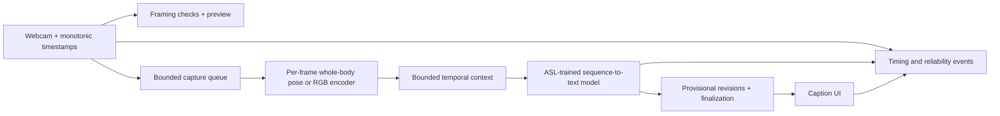

# ASL recognition first, continuous translation later

## Current priority — updated 2026-11-07

2026-11-13 diagnostic workflow: guided attempts and an optional fixed 39-attempt
set support failure analysis. Video recording is opt-in, local and without audio;
reports exclude image and landmark arrays. No automatic cloud upload or training.
This is evaluation tooling, not completion of the recognition or translation goal.

Implementation update 2026-11-08: the experimental vocabulary is HELLO,
THANKYOU, PLEASE, SORRY, YES, NO, HELP, WATER, BOOK and dataset variant MILK1.
The webcam prototype exists but has not met recognition quality requirements.
The user authorizes free Colab/Kaggle training experiments; paid resources remain
unauthorized. Local CPU experiments and a private Colab workflow are implemented.
Training and the final local application remain separate environments.

Following the user's scope discussion, the first deliverable is local webcam recognition of a limited set of individual ASL signs. Continuous live ASL-to-English translation remains a later research objective. Success on individual signs does not satisfy the translation contract below or guarantee that a classifier can be extended into a translator.

Initial proposal: start with 10 signs, selected after checking reliable labeled data, licensing, signer coverage and visual ambiguity. Support movement with short temporal sequences when needed. Display recognized sign labels, include unknown/no-sign handling, avoid duplicate detections while holding a sign, and provide camera preview plus start/stop/reset. Run inference on the existing laptop; measure actual CPU speed and memory before selecting an architecture. No cloud or paid services are required by this scope decision.

Evaluation must include held-out people/source recordings, per-class errors, false activations during ordinary movements, response delay and session behavior. Unknown-input rejection must be evaluated rather than inferred from a high classifier probability. With no ASL reviewer available, use documented dataset labels and disclose limits on independent linguistic validation.

Reusable for the later project: camera controls, timestamped processing, input checks, UI, logging and evaluation discipline. Continuous ASL translation requires a separate data/model investigation for grammar, coarticulation, boundaries and sentence meaning; concatenating recognized labels is not the proposed upgrade.

The following specification is retained for the **later continuous-translation phase**. Its model choices, domain and stage gates do not automatically apply to the current sign-recognition deliverable.

Original translation specification: 2026-11-07 (Asia/Calcutta). Numerical targets and technical design below remain drafts.

## Product contract

One person signs continuous ASL into a stationary webcam, with hands, face and upper body visible. English captions must begin while signing continues. Provisional text may change; finalized text has an explicit finalization rule and visible corrections. Recorded-video translation is an intermediate milestone, never the final deliverable.

This is an experimental accessibility-oriented application, not a certified interpreter. Initial conditions: adequate lighting, limited clutter, one signer, fixed camera. Initial research domain: instructional/how-to content represented in How2Sign. Supported topics and vocabulary will be narrowed using measured errors; no fixed vocabulary size or unrestricted conversational capability is claimed. English vocabulary counts are not a count of recognized ASL signs.

The solution must learn/perform sequence-to-text translation. Fingerspelling, isolated classifiers, label concatenation, fixed-sentence retrieval, and ungrounded language-model completions cannot satisfy this contract. ASL has its own grammar; sentence translations are not word-level temporal labels.

## User workflow

1. Open the app and see the experimental-use notice, camera permission and local/remote processing status.
2. Preview framing, lighting and hand/face visibility. Checks describe detectable input problems, not translation confidence.
3. Start. See a live preview, processing status, visibly provisional captions, and a separate finalized transcript.
4. Continue through ordinary pauses. A pause may be part of the same utterance.
5. Stop releases the camera and triggers a bounded final pass over already received frames. If evidence is incomplete or processing fails, retain an explicit incomplete segment rather than invent a finish.
6. Reset cancels work, clears buffers/captions and changes the session generation ID. Late responses from the old session are discarded.
7. Disconnection or overload produces an honest status and a visible continuity gap. Reconnect starts fresh context; it does not replay arbitrarily stale video.

## Resources and preferences

User confirmed initial spending limit: INR 0. No billable jobs, trials that can incur charges, or service purchases are authorized. Free notebook availability is a dependency, not a guarantee. No competent ASL reviewer is currently available.

Read-only hardware inspection: Intel Core i5-1235U, 10 cores / 12 logical processors, 15.71 GiB physical RAM, Intel UHD integrated graphics; C: approximately 480.49 GiB free and D: 87.41 GiB free at inspection. Python 3.14.3 is installed; FFmpeg was not found on PATH. Wi-Fi link speed is 287 Mbps; internet upload/download capacity and RTT remain unmeasured. Do not confuse these rates. Free memory and disk change during use.

Default planning preference: local camera/UI, isolated cloud notebook for GPU experiments, investigate local CPU inference first. Remote or hybrid hosting remains an option to discuss after measurements. No deployment service or external upload of webcam video is selected. Notebook experiments do not establish hosting reliability.

## Proposed architecture, not implemented

Conditional first experiment: pretrained Uni-Sign How2Sign pose-to-text checkpoint. Preserve body, both hands and facial landmarks during extraction; reproduce its required input ordering for baseline inference. Its selected face points omit much facial detail, so successful facial-expression handling is unproven. Keep the ability to compare RGB features later. Do not replace RTMPose with MediaPipe without an explicit compatibility/domain-shift experiment. RGB retains appearance but costs more compute; combined RGB/pose adds alignment and deployment complexity. Select the final representation using evidence, not just bandwidth.

The model's language decoder is already a language model. Initially there is no separate fluent-text rewriting stage. Save raw hypotheses alongside displayed text; negative visual controls must reveal how much the decoder relies on visual evidence.

## Draft streaming policy for Stage 5

All durations below are initial experiment settings, not achieved targets or settled model limits.

- Timestamp at capture, enqueue, preprocessing completion, inference start/end, result receipt and display. Resample from observed timestamps; use only arrived frames. Declare effective frame rate and dropped/gapped input.
- Start with a 30-second timestamped pose/context ring and explicit model token/frame caps. Bound the raw-frame queue to 2 frames, pending decoding to 1 replaceable request and active decoding to 1. Count bytes as well as items. Discard raw frames after processing unless recording was explicitly enabled.
- Try decoding every 1 second after 2 seconds of context. These are tunable; a decoder slower than the requested cadence must coalesce work. Discard results from an obsolete session or superseded context version. If input age exceeds a trial 2-second deadline, shed stale pending work and show a gap/degraded status. Do not silently time-compress the remaining motion.
- Whole-prefix recomputation is the initial causal experiment. A bidirectional encoder may attend throughout the prefix available at that instant, but cannot see later frames. Whole-recording normalization, centered interpolation, global cropping and cached future-informed features are forbidden. Recompute prefix-dependent features; cache only representations proven invariant to later frames.
- Keep utterance and revision IDs. While an utterance is open, replace its provisional hypothesis; never append every overlapping-window translation. Repeated legitimate words must survive. Context overlap is input context, not a second caption owner.
- Candidate finalization: an inactivity candidate of at least 1.5 seconds, decoder end-of-sequence, and identical normalized full hypotheses on 3 decodes spanning at least 2 seconds. Require all signals for automatic finalization; motion alone and decoder EOS alone are inadequate. Stability is not correctness. Tune false boundaries on internal pauses and slow signing. An explicit Stop can close a segment without passing the automatic rule and must be logged distinctly.
- If the context limit is reached without a boundary, show a forced segment/gap marker and an incomplete segment; do not call that a linguistic sentence boundary. Carry bounded overlap with ownership metadata. Evaluate how often this happens and whether long sentences remain supported before accepting the design.
- Finalized text is never silently overwritten. A later correction is a visible amendment linked to the original segment with an audit event. Corrections count in stability and fidelity reports.

## Privacy and recovery contract

Default intended retention: transient frames/features only, no persisted camera video, no raw video or text in telemetry by default. Explicit opt-in recordings for evaluation need a location and deletion policy. Landmarks remain potentially identifying; they are not anonymous. If remote inference is selected, document payload, encryption, retention, provider behavior, authentication, network limits and disconnect handling before using it. Training data and hosting environments stay separate.

## Stages and gates

| Stage | Reviewable output | Gate |
|---|---|---|
| 0 | Specification, source audit, feasibility experiment, risk register, acceptance draft | Affordable offline route and plausible live path justified |
| 1 | Isolated environment, modules, configs, small manifests, decoding/alignment checks | Clean correctly paired run without manual notebook fixes |
| 2 | Offline translation CLI, fixed dev results, fidelity failures, runtime/memory | Genuine visual sequence-to-text behavior with understood limitations |
| 3 | One failure-driven hypothesis, baseline comparison and ablation | Evidence determines whether to retain the change |
| 4 | Webcam preview/recording and complete-utterance translation | Camera pipeline works; domain shift documented |
| 5 | Causal replay, bounded buffers, revisions, boundaries and timings | Useful captions before utterance end; bounded backlog |
| 6 | Live controls, selected hosting, privacy and recovery | Measured operation on this machine/connection |
| 7 | Frozen final evaluation, reproducibility, live demo, provenance, interview narrative | Another developer can reproduce the claims |

We will not silently change the objective or lower acceptance targets. If resources do not support useful live translation, document that result and discuss compute, scope or research alternatives.
